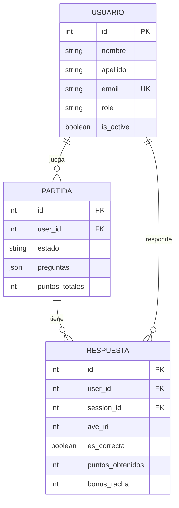

# 🐦 AvesBA API — Proyecto Taller de Programación 2

API REST del juego **AvesBA**, hecha con **Node.js + Express** y la **arquitectura en capas** que vimos en la materia:

```
rutas → controladores → casos de uso → DAO
```

Tiene persistencia intercambiable (memoria ↔ SQLite), un contenedor que inyecta las dependencias, eventos para los efectos secundarios, validación con Zod, login con JWT y documentación con Swagger.

| | |
|---|---|
| 📖 **Documentación de la API (Swagger)** | `http://localhost:8000/api-docs`, con el servidor levantado |
| 🧭 **Guía del código**, archivo por archivo | [GUIA.md](GUIA.md) |
| 🧪 **Pruebas a mano** | [requests.http](requests.http) (extensión REST Client de VS Code) |
| ✅ **Tests automáticos** | `npm test`: 290 tests |

---

## Índice

1. [¿De qué se trata?](#1-de-qué-se-trata-el-negocio)
2. [Dominio: entidades y relaciones](#2-dominio-entidades-y-relaciones)
3. [Reglas de negocio](#3-reglas-de-negocio)
4. [Herramientas utilizadas](#4-herramientas-utilizadas)
5. [Requisitos previos](#5-requisitos-previos)
6. [Cómo levantar el proyecto](#6-cómo-levantar-el-proyecto-paso-a-paso)
7. [Variables de entorno](#7-variables-de-entorno)
8. [Cómo cambiar de persistencia](#8-cómo-cambiar-de-persistencia-memoria--sqlite)
9. [Documentación de la API (Swagger)](#9-documentación-de-la-api-swagger)
10. [Usuarios de prueba](#10-usuarios-de-prueba)
11. [Eventos y notificaciones](#11-eventos-y-notificaciones)
12. [Arquitectura](#12-arquitectura)
13. [Estructura de carpetas](#13-estructura-de-carpetas)
14. [Seguridad](#14-seguridad)
15. [Manejo de errores](#15-manejo-de-errores)
16. [Tests](#16-tests)
17. [Cosas a tener en cuenta](#17-cosas-a-tener-en-cuenta)
18. [Cumplimiento de la consigna](#18-cumplimiento-de-la-consigna)

---

## 1. ¿De qué se trata? (el negocio)

**AvesBA** es un juego para **aprender a reconocer las aves de Buenos Aires**.

El jugador ve la **foto real de un ave** y tiene que adivinar cuál es entre **4 opciones**. Cada partida tiene **10 preguntas**:

- Cada acierto suma **10 puntos**.
- Acertar varias seguidas da **puntos extra por racha**.
- Al terminar, el puntaje entra en un **ranking** general.

Las fotos y los nombres salen de **[iNaturalist](https://www.inaturalist.org)**, una red de ciencia ciudadana donde personas de todo el mundo suben fotos de animales y plantas, verificadas por la comunidad. Pedimos las especies **nativas** que hay en Buenos Aires, y a las más conocidas les ponemos el **nombre que se usa acá** (por ejemplo "Biguá" en vez de "Corúa Neotropical").

**¿Para quién es?**
- **Jugadores**: juegan, ven su progreso y se comparan en el ranking.
- **Moderadores**: además ven a los usuarios y las estadísticas de todo el sistema.
- **Administradores**: además gestionan usuarios (crear, editar, eliminar, resetear contraseñas) y pueden borrar partidas.

Este backend es el que usa el frontend de AvesBA (Vue), que se desarrolló en otra materia. Por eso respeta los mismos nombres de campos y rutas que ese front espera.

---

## 2. Dominio: entidades y relaciones

| Entidad | Qué representa | Campos principales |
|---|---|---|
| **Usuario** (`users`) | Una persona registrada | `id`, `nombre`, `apellido`, `email` (único), `passwordHash`, `role` (`jugador` / `moderador` / `admin`), `is_active`, `createdAt`, `lastLogin` |
| **Partida** (`game_sessions`) | Un juego de 10 preguntas | `id`, `user_id`, `estado` (`activa` / `terminada`), `preguntas` (el lote, en JSON), `streak_actual`, `streak_maximo`, `puntos_totales`, `total_intentos`, `total_aciertos`, `createdAt`, `terminadaAt` |
| **Respuesta** (`game_results`) | Lo que respondió el jugador a una pregunta | `id`, `user_id`, `session_id`, `ave_id`, `ave_nombre`, `respuesta_usuario`, `es_correcta`, `puntos_obtenidos`, `bonus_racha` |

**Usuario** y **Partida** tienen **CRUD completo** (listar, ver, crear, actualizar y eliminar).

### Relaciones

```
┌──────────────┐ 1        N ┌──────────────┐ 1        N ┌──────────────┐
│   Usuario    │───────────▶│   Partida    │───────────▶│  Respuesta   │
│   (users)    │   juega    │(game_sessions│   tiene    │(game_results)│
└──────────────┘            └──────────────┘            └──────────────┘
       │ 1                                                     ▲ N
       └───────────────────── responde ────────────────────────┘
```



- Un **usuario** juega **muchas partidas** (1 a N).
- Una **partida** tiene **muchas respuestas** (1 a N). `GET /partidas/:id` devuelve la partida con sus respuestas.
- Las relaciones de Sequelize están centralizadas en `dao/models/index.js`.

---

## 3. Reglas de negocio

Todas viven en los **casos de uso** (`usecases/`), no en las rutas ni en los controladores.

| Regla | Dónde | Error si no se cumple |
|---|---|---|
| El email no se puede repetir | `usecases/users/createUser.js` | 409 `EMAIL_DUPLICATED` |
| Quien se registra es siempre `jugador` (no puede elegir su rol) | `usecases/auth/registerUser.js` | — se ignora el rol |
| Un admin no puede eliminarse a sí mismo | `usecases/users/deleteUser.js` | 409 `CANNOT_DELETE_SELF` |
| Un jugador solo ve sus datos y sus partidas | `usecases/users/getUserById.js`, `usecases/partidas/assertCanAccess.js` | 403 `FORBIDDEN` |
| Una partida terminada no se puede volver a terminar | `usecases/partidas/finishPartida.js` | 409 `PARTIDA_ALREADY_FINISHED` |
| No se puede responder dos veces la misma ave en una partida | `usecases/game/answerQuestion.js` | 400 `ALREADY_ANSWERED` |
| La respuesta se compara contra el lote **guardado** (el cliente no puede hacer trampa) | `usecases/game/answerQuestion.js` | 400 `BIRD_NOT_IN_BATCH` |
| Al iniciar una partida se cierran las que estaban activas | `usecases/game/startGame.js` | — |
| Racha: +5 puntos a los 3 aciertos seguidos, +15 a los 5 y +50 a los 10 | `usecases/game/gameRules.js` | — |
| 5 logins fallidos con el mismo email bloquean 15 minutos | `usecases/auth/loginUser.js` | 429 `TOO_MANY_ATTEMPTS` |
| Para cambiar la contraseña hay que mandar la actual | `usecases/users/changePassword.js` | 400 `WRONG_PASSWORD` |

---

## 4. Herramientas utilizadas

| Herramienta | Versión | Para qué la usamos |
|---|---|---|
| **Node.js** | 22+ (probado con 24) | Ejecutar JavaScript en el servidor. Usamos **ES Modules** (`import`/`export`). |
| **Express** | 5.3 | El servidor HTTP: rutas, middlewares y respuestas. |
| **Zod** | 4.6 | Validar lo que llega en `body`, `query` y `params`. |
| **Sequelize** | 6.37 | ORM: trabajar con la base de datos usando clases y objetos en vez de SQL a mano. |
| **sqlite3** | 6.0 | El motor de base de datos SQLite: la base es un archivo (`database.sqlite`). |
| **bcryptjs** | 3.0 | Guardar las contraseñas como hash (nunca en texto plano). |
| **jsonwebtoken** | 9.0 | Crear y verificar los tokens JWT del login. |
| **cookie-parser** | 1.4 | Leer las cookies donde viaja el token (así lo usa el front). |
| **cors** | 2.8 | Permitir que el front (otro origen, `localhost:5173`) llame a la API con cookies. |
| **swagger-ui-express** | 5.0 | Publicar la documentación interactiva en `/api-docs`. |
| **yaml** | 2.9 | Leer `docs/openapi.yaml`, donde está escrita la documentación OpenAPI 3. |
| **node:test** | (viene con Node) | Los tests automáticos, sin instalar nada. |
| **node:events** | (viene con Node) | El bus de eventos (`EventEmitter`). |
| **fetch** | (viene con Node) | Consumir la API externa de iNaturalist. |
| **REST Client** | extensión de VS Code | Probar la API a mano con `requests.http`. |
| **iNaturalist API** | v1 (pública) | De donde salen las fotos y nombres de las aves. |

---

## 5. Requisitos previos

- **Node.js 22 o superior.** Verificalo con `node --version`.
- **npm**, que viene con Node.
- **Internet**, para traer las aves de iNaturalist. Para trabajar sin conexión, ver [Cosas a tener en cuenta](#17-cosas-a-tener-en-cuenta).
- Opcional: **VS Code** con la extensión **REST Client**.

---

## 6. Cómo levantar el proyecto (paso a paso)

**1. Clonar el repositorio**

```bash
git clone https://github.com/Gaston-Sartini/proyecto-tp2-avesba.git
cd proyecto-tp2-avesba
```

**2. Instalar las dependencias**

```bash
npm install
```

> ⚠️ **Si `npm install` avisa que bloqueó `sqlite3`** (las versiones nuevas de npm no ejecutan scripts de instalación sin permiso), aprobalo una vez. Sin esto, SQLite no funciona:
> ```bash
> npm install-scripts approve sqlite3
> npm rebuild sqlite3
> ```

**3. Crear el archivo `.env`** a partir del ejemplo

```bash
cp .env.example .env
```

En Windows (PowerShell): `Copy-Item .env.example .env`.

Abrí `.env` y **cambiá `JWT_SECRET`** por un texto largo cualquiera. Es obligatorio: sin él la app no arranca.

**4. Levantar el servidor**

```bash
npm run dev     # se reinicia solo al guardar cambios
# o
npm start       # modo normal
```

Vas a ver algo así:

```
[Persistencia] Usando Sequelize (SQLite)
[Aves] Usando iNaturalist
[Notificaciones] Usando consola
[seed] 100 jugadores de prueba creados (contraseña: Jugador123)
Servidor AvesBA corriendo en http://localhost:8000
```

La primera vez crea la base `database.sqlite` con el admin y 100 jugadores de prueba con partidas jugadas. Las siguientes veces, los datos ya están.

**5. Probarlo**

- Abrí **http://localhost:8000/api-docs** y usá "Try it out". Ver [cómo](#9-documentación-de-la-api-swagger).
- O abrí `requests.http` en VS Code y mandá los pedidos en orden.
- O levantá el **frontend de AvesBA**: busca la API en `http://localhost:8000`.

**6. Correr los tests**

```bash
npm test
```

---

## 7. Variables de entorno

Se leen **solamente** en `config/config.js`. El `.env` **no se sube a Git**; `.env.example` es la plantilla.

| Variable | Valor por defecto | Para qué sirve |
|---|---|---|
| `PORT` | `8000` | Puerto del servidor |
| `NODE_ENV` | `development` | `production` activa las cookies `secure` (solo HTTPS) |
| `APP_NAME` / `APP_VERSION` | `AvesBA API` / `1.0.0` | Lo que responde `GET /` |
| `CORS_ORIGIN` | `http://localhost:5173` | Desde qué páginas web se puede llamar a la API (separadas por coma) |
| **`PERSISTENCE_TYPE`** | `memory` | **`memory`** (array de JS, se borra al reiniciar) o **`sequelize`** (SQLite) |
| `DB_STORAGE` | `./database.sqlite` | Archivo de la base (`:memory:` = base en memoria) |
| `NOTIFIER_TYPE` | `console` | Dónde van los avisos de los eventos: `console`, `file` (`notifications.log`) o `none` |
| `BIRDS_PROVIDER` | `inaturalist` | `inaturalist` (real, necesita internet) o `fake` (15 aves de prueba, sin internet) |
| **`JWT_SECRET`** | *(ninguno)* | **Obligatorio.** Secreto para firmar los tokens. Si falta, la app no arranca. |
| `ACCESS_TOKEN_EXPIRE_MINUTES` | `15` | Cuánto dura el token de acceso |
| `REFRESH_TOKEN_EXPIRE_DAYS` | `7` | Cuánto dura el token para renovar |
| `BCRYPT_ROUNDS` | `10` | Qué tan lento (y seguro) es el hash de contraseñas |
| `LOGIN_MAX_ATTEMPTS` / `LOGIN_LOCK_MINUTES` | `5` / `15` | Bloqueo del login por intentos fallidos |
| `ADMIN_EMAIL` / `ADMIN_PASSWORD` | `admin@avesba.com` / *(ninguno)* | El administrador que se crea al arrancar. Sin contraseña, no se crea. |
| `SEED_PLAYERS` / `SEED_PLAYERS_PASSWORD` | `100` / `Jugador123` | Cuántos jugadores de prueba cargar (0 = ninguno) y su contraseña |

---

## 8. Cómo cambiar de persistencia (memoria ↔ SQLite)

Cambiás **una sola línea** en el `.env` y reiniciás el servidor. **No se toca nada de código.**

```env
PERSISTENCE_TYPE=memory      # los datos viven en arrays de JS (se pierden al reiniciar)
PERSISTENCE_TYPE=sequelize   # los datos viven en SQLite (database.sqlite, quedan guardados)
```

Al arrancar, la consola confirma cuál se está usando: `[Persistencia] Usando Memoria (Array JS)` o `[Persistencia] Usando Sequelize (SQLite)`.

**¿Cómo funciona por dentro?**

1. `dao/daoFactory.js` lee `PERSISTENCE_TYPE` y devuelve el DAO que corresponde: `UsersMemoryDao` o `UsersSequelizeDao`, y lo mismo con partidas y respuestas.
2. Los dos DAOs de cada entidad tienen **exactamente los mismos métodos**: `getAll`, `getById`, `save`, `update`, `delete`… y devuelven **objetos planos** de JavaScript.
3. El contenedor (`container/container.js`) le pasa el DAO a los casos de uso. Los casos de uso, controladores y rutas **no saben cuál les tocó**.

**Los dos modos responden igual:** todos los tests de la API corren dos veces, una con cada persistencia, con los mismos pedidos y esperando las mismas respuestas.

---

## 9. Documentación de la API (Swagger)

Con el servidor levantado: **http://localhost:8000/api-docs**

- Documenta **los 28 endpoints**: método, ruta, descripción, parámetros, body con ejemplos y todas las respuestas posibles (éxito y errores).
- Los schemas (`User`, `Partida`, `Respuesta`, `Error`…) están en `components/schemas` y se reutilizan con `$ref`.
- El documento está en **`docs/openapi.yaml`** (OpenAPI 3). También se puede descargar en JSON desde `/api-docs.json`.
- Hay un test que verifica que **todas las rutas del código estén documentadas** y que todos los `$ref` existan.

**Cómo probar con "Try it out":**

1. Abrí `POST /auth/login` → **Try it out** → elegí el ejemplo `admin` o `jugador` → **Execute**.
2. Copiá el `access_token` de la respuesta.
3. Tocá **Authorize** (arriba a la derecha), pegalo en `bearerAuth` y confirmá.
4. Ya podés probar cualquier endpoint protegido.

Funciona igual con `PERSISTENCE_TYPE=memory` y con `PERSISTENCE_TYPE=sequelize`.

> El listado completo de endpoints está en Swagger. Resumen por recurso:
> `/auth` (registro, login, refresh, logout) · `/users` (CRUD + mi perfil + contraseña) · `/partidas` (CRUD) ·
> `/api/inaturalist/juego` (el flujo del juego que usa el front) · `/api/inaturalist/metricas` · `/api/user-connection-log`

---

## 10. Usuarios de prueba

Se crean solos al arrancar por primera vez:

| Rol | Email | Contraseña |
|---|---|---|
| **admin** | `admin@avesba.com` | `admin12345` (sale de `ADMIN_PASSWORD`) |
| **moderador** | `jugador001@example.com` a `jugador003@example.com` | `Jugador123` |
| **jugador** | `jugador004@example.com` a `jugador100@example.com` | `Jugador123` |

Cada jugador de prueba tiene entre 1 y 5 partidas terminadas, simuladas con las mismas reglas del juego real. Así el ranking y las métricas tienen datos desde el principio.

---

## 11. Eventos y notificaciones

Los casos de uso **avisan que algo pasó** (emiten un evento) y **no saben quién escucha**. Un módulo aparte (`alerts/`) escucha y decide qué hacer, a través de un **notificador** que se puede cambiar sin tocar las reglas de negocio.

```
caso de uso ──emit("game.finished")──▶ bus (EventEmitter) ──▶ listener (alerts/) ──▶ notificador
                                                                                     (consola / archivo / nada)
```

| Evento | Lo emite | Cuándo | Qué hace el listener |
|---|---|---|---|
| `user.registered` | `createUser` | Se crea un usuario | Manda la **bienvenida**: *"Se registró Juan Pérez <juan@...>"* |
| `game.finished` | `closeSession` | Termina una partida | Avisa el **resultado**: *"El usuario 5 hizo 35 puntos (3/4 aciertos)"* |
| `game.streakAchieved` | `answerQuestion` | El jugador logra una racha con bonus | Avisa la **racha**: *"El usuario 5 lleva 3 aciertos seguidos (+5 pts de bonus)"* |
| `user.disconnected` | `logConnection` | El front avisa que se cerró la pestaña | Registra **cuánto estuvo conectado** |

- **Bus de eventos:** `events/eventBus.js`. Se crea **una vez** en el contenedor y se inyecta en los casos de uso.
- **Nombres de los eventos:** `events/eventNames.js`.
- **Listener:** `alerts/registerAlertListeners.js`. **Atrapa sus propios errores**: si el notificador falla, la operación que emitió el evento **sigue funcionando** (hay un test que lo comprueba).
- **Notificadores** (todos con la misma interfaz `notify({ subject, body })`):
  - `consoleNotifier`: los muestra en la consola.
  - `fileNotifier`: los agrega a `notifications.log`.
  - `silentNotifier`: no hace nada (lo usan los tests).
  - Se elige con `NOTIFIER_TYPE` en `notifications/notifierFactory.js`.

---

## 12. Arquitectura

```
                      Pedido HTTP
                           │
┌──────────────────────────▼──────────────────────────┐
│ app.js: middlewares globales                        │  cors → logger → express.json → cookieParser
├─────────────────────────────────────────────────────┤
│ routes/: qué URL va a qué controller                │  + middlewares por ruta:
│                                                     │    authenticate → authorize → validate (Zod)
├─────────────────────────────────────────────────────┤
│ controllers/: traducen HTTP ↔ casos de uso          │  leen req, responden con res. Sin reglas.
├─────────────────────────────────────────────────────┤
│ usecases/: LAS REGLAS DEL NEGOCIO                   │  no conocen Express ni la base de datos
├─────────────────────────────────────────────────────┤
│ dao/: acceso a los datos (memoria o Sequelize)      │  devuelven objetos planos
└─────────────────────────────────────────────────────┘
   Si algo falla en cualquier capa → AppError → middlewares/errorHandler.js → { error: { code, message } }
```

**Inversión de dependencias:** nadie importa lo que necesita, se lo pasan.

- Los **casos de uso** reciben los DAOs, el hasheador, los tokens y el bus de eventos por parámetro, a través de su factory `makeXxxUseCases`.
- Los **controladores** reciben los casos de uso en el constructor. **No conocen ningún DAO.**
- Los **routers** reciben el controlador y los middlewares de auth.
- El único lugar que conoce las piezas concretas y las conecta es el **Composition Root**: `container/container.js`.

**`index.js` y `app.js`.** `index.js` solo arranca el servidor: llama a `createApp()` y hace `listen`. `app.js` arma la app (middlewares globales, el router que entrega el contenedor, `notFound` y `errorHandler`). Están separados para que los **tests** puedan crear una app sin abrir el puerto 8000.

📖 La explicación completa, archivo por archivo y con el recorrido de un pedido, está en **[GUIA.md](GUIA.md)**.

---

## 13. Estructura de carpetas

```
├── index.js              Arranca el servidor
├── app.js                Arma la app Express (middlewares, rutas del contenedor, errores)
├── .env.example          Plantilla de variables de entorno
├── requests.http         Pruebas a mano (REST Client)
├── config/               Configuración (lee el .env)
├── container/            Composition Root: crea y conecta todas las piezas
├── routes/               Rutas de cada recurso (factories que reciben el controller)
├── controllers/          Controladores (clases que reciben los casos de uso)
├── usecases/             Reglas de negocio: auth/ users/ partidas/ game/ metrics/ activity/ seed/
├── dao/                  Acceso a datos
│   ├── daoFactory.js     Elige memoria o Sequelize
│   ├── models/           Modelos de Sequelize y sus relaciones (index.js)
│   ├── users/            UsersMemoryDao + UsersSequelizeDao
│   ├── gameSessions/     Partidas (memoria + Sequelize)
│   └── gameResults/      Respuestas (memoria + Sequelize)
├── connection/           Conexión a SQLite
├── schemas/              Validaciones con Zod
├── middlewares/          logger, auth, validate, notFound, errorHandler, parseTextJson
├── errors/               AppError
├── security/             bcrypt, JWT, bloqueo de login
├── events/               Bus de eventos y nombres de eventos
├── alerts/               Listeners de los eventos
├── notifications/        Notificadores (consola, archivo, silencioso)
├── birds/                Proveedor de aves (iNaturalist o falso) y nombres argentinos
├── docs/                 openapi.yaml + Swagger UI
└── tests/                Tests automáticos (unit/ y api/)
```

---

## 14. Seguridad

- **Contraseñas:** se guardan como **hash de bcrypt** (empiezan con `$2`), nunca en texto plano. Ningún endpoint devuelve el hash: el único método que lo lee es `getCredentialsByEmail`, que se usa solo en el login.
- **Login con JWT**, con dos tokens:
  - `access_token` (15 min): es el que abre la API.
  - `refresh_token` (7 días): solo sirve para pedir un access nuevo en `POST /auth/refresh`.
- **Dónde viaja el token:** en el header `Authorization: Bearer <token>` (Swagger, REST Client, Postman) **o** en una **cookie httpOnly** (el front de AvesBA). La cookie no se puede leer desde JavaScript, y eso protege contra robos por XSS.
- **Roles:** el middleware `authorize("admin")` controla quién puede usar cada ruta. Las reglas "solo lo tuyo" van en los casos de uso.
- **Sin escalada de privilegios:** el registro público siempre crea jugadores, aunque manden `role: "admin"`.
- **Bloqueo de login:** después de 5 intentos fallidos con el mismo email.
- **El token fija el algoritmo HS256:** se rechazan tokens sin firma o modificados.

---

## 15. Manejo de errores

Todos los errores tienen **el mismo formato** y los arma **un único middleware** (`middlewares/errorHandler.js`):

```json
{
  "error": {
    "code": "VALIDATION_ERROR",
    "message": "Datos de body inválidos",
    "details": [{ "field": "password", "message": "La contraseña debe tener al menos 8 caracteres" }]
  },
  "detail": "La contraseña debe tener al menos 8 caracteres"
}
```

- `code`: estable, para que lo use el código del front.
- `message`: para personas.
- `details`: solo en errores de validación, uno por campo.
- `detail`: el texto que muestra el front de AvesBA.

| Código HTTP | Cuándo |
|---|---|
| **200** | OK |
| **201** | Se creó algo (`POST /auth/register`, `POST /users`, `POST /partidas`) |
| **204** | Se borró, sin cuerpo (`DELETE /users/:id`, `DELETE /partidas/:id`) |
| **400** | Datos inválidos (Zod) o JSON roto |
| **401** | Sin token, token inválido o vencido, credenciales incorrectas |
| **403** | Sin permiso para esa acción |
| **404** | No existe (o la ruta no existe: middleware `notFound`) |
| **409** | Conflicto: email repetido, partida ya terminada, borrarse a uno mismo |
| **429** | Demasiados intentos de login |
| **503** | iNaturalist no responde |
| **500** | Error inesperado (se muestra en la consola del servidor) |

Los errores esperados se lanzan con **`AppError`** (`errors/AppError.js`), que tiene `code`, `message`, `statusCode` y `details`.

---

## 16. Tests

```bash
npm test
```

- **290 tests**, en unos 10 segundos, con el runner que viene con Node (`node:test`).
- **No necesitan internet ni tocan tu base:** usan SQLite en memoria y un proveedor de aves falso.
- **Tests unitarios** (`tests/unit/`): reglas del juego, armado de preguntas, ranking, seguridad, y el **contrato de los DAOs** (los de memoria y los de SQLite tienen que comportarse igual).
- **Tests de la API** (`tests/api/`): cada endpoint con sus casos de éxito y de error, **corridos en los dos modos de persistencia**. También verifican eventos, CORS, el arranque y que Swagger documente todas las rutas.

---

## 17. Cosas a tener en cuenta

- 🔑 **Sin `JWT_SECRET` la app no arranca** (a propósito). Copiá `.env.example` como `.env`.
- 🧱 **`sqlite3` bloqueado por npm:** ver el paso 2 de [cómo levantar el proyecto](#6-cómo-levantar-el-proyecto-paso-a-paso).
- 🌐 **iNaturalist necesita internet.** Sin conexión, poné `BIRDS_PROVIDER=fake` y vas a jugar con 15 aves de prueba.
- 🔌 **Puerto 8000 ocupado** (`EADDRINUSE`): hay otro programa usándolo, por ejemplo otro servidor. Cerralo o cambiá `PORT`.
- 🗑️ **Empezar con la base vacía:** frená el servidor y borrá `database.sqlite` (y `database.sqlite-wal` / `-shm` si están). Al arrancar se crea de nuevo con los datos de prueba.
- 💾 **En modo `memory` todo se pierde al reiniciar**, y los datos de prueba se vuelven a generar.
- ⏱️ **El token dura 15 minutos.** Si empiezan los 401, volvé a hacer login o usá `POST /auth/refresh`.
- 🌍 **CORS:** si el front corre en otra dirección, agregala en `CORS_ORIGIN`.
- 🚫 **No se suben a Git:** `node_modules/`, `.env`, `database.sqlite` y `notifications.log` (ver `.gitignore`).

---

## 18. Cumplimiento de la consigna

| Requisito | Dónde está |
|---|---|
| Node + ES Modules + Express | Todo el proyecto (`"type": "module"`) |
| `index.js` limpio | `index.js` (solo arranca) + `app.js` (monta el router del contenedor) |
| Carpetas por responsabilidad | `routes/` `controllers/` `usecases/` `dao/` `schemas/` `middlewares/` `errors/` `config/` `container/` |
| Configuración centralizada + `.env.example` | `config/config.js`, `.env.example` |
| 2 entidades con CRUD completo | **Usuarios** (`/users`) y **Partidas** (`/partidas`) |
| Relación 1 a N | Usuario → Partidas → Respuestas (`dao/models/index.js`) |
| Regla de negocio en un caso de uso | Ver [Reglas de negocio](#3-reglas-de-negocio) |
| Zod en body, params y query con middleware reutilizable | `middlewares/validate.js` + `schemas/` |
| `AppError`, un único `errorHandler` y `notFound` | `errors/AppError.js`, `middlewares/errorHandler.js`, `middlewares/notFound.js` |
| Formato de error consistente | `{ error: { code, message, details } }` |
| Códigos 200, 201, 204, 400, 404, 409 y 500 | Ver [Manejo de errores](#15-manejo-de-errores) |
| Dos DAOs por entidad con la misma interfaz | `dao/*/…MemoryDao.js` y `dao/*/…SequelizeDao.js` |
| Factory de DAOs con `PERSISTENCE_TYPE` | `dao/daoFactory.js` |
| DAOs devuelven objetos planos | `get({ plain: true })` en Sequelize, copias en memoria |
| Asociaciones centralizadas | `dao/models/index.js` |
| Contenedor con `makeXxxUseCases` | `container/container.js`, `usecases/*/make…UseCases.js` |
| Bus de eventos inyectado + evento de dominio + listener + notificador | `events/`, `alerts/`, `notifications/` |
| Swagger / OpenAPI 3 en `/api-docs` con `$ref` | `docs/openapi.yaml`, `docs/swagger.js` |
| README | Este archivo |
| **Opcional:** filtros, orden y paginación | `GET /partidas?estado=&sort=&page=`, `GET /users?role=&page=` |
| **Opcional:** segundo evento con notificador adicional | 4 eventos; notificadores de consola y archivo |
| **Opcional:** tests de los casos de uso | `tests/` (290 tests, con el DAO en memoria como doble) |
| **Opcional:** seguridad (hash y JWT) | `security/`, `middlewares/auth.js` |
